<!-- ═══════════════════════════════════════════════════════════════════════
     TAURUS TRADE & LOGISTICS ERP — README
     NOTE: replace every  YOUR_GITHUB_USER/Taurus-logistics  with your real repo path
     ═══════════════════════════════════════════════════════════════════════ -->

<div align="center">


<a href="https://git.io/typing-svg">

</a>

<br/>

[](https://www.djangoproject.com/)
[](https://www.django-rest-framework.org/)
[](https://reactjs.org/)
[](https://www.mysql.com/)
[](https://www.python.org/)
[](https://jwt.io/)
[](https://railway.app/)


<br/>

> ### 🚛 A production-grade, multi-branch Logistics ERP
> Manage **fleet, fuel, inventory, trips, invoicing, finance and reporting** across multiple branches — with **full data isolation** and **role-based access control** enforced at the database queryset level.

<br/>


<br/>

| 🚛 Fleet Management | ⛽ Fuel Control | 📦 Inventory Ledger |
|:---:|:---:|:---:|
| Trucks · Drivers · Trips · Tyres | Per-truck limits · Excess detection | Double-entry · Never a static field |
| **💰 Invoicing & Finance** | **📊 Live Reports** | **🔐 Multi-Branch RBAC** |
| PDF invoices · VAT · Payments | 10+ reports · PDF/Excel | 4 tiers · Branch-scoped APIs |

<br/>

[**✨ Features**](#-features) ·
[**🏗️ Architecture**](#️-architecture) ·
[**🚀 Quick Start**](#-quick-start) ·
[**📡 API**](#-api-reference) ·
[**🔐 Security**](#-security) ·
[**🗺️ Roadmap**](#️-roadmap)

</div>


## 📑 Table of Contents

<details open>
<summary><b>Click to expand / collapse</b></summary>
<br/>

1. [✨ Features](#-features)
2. [📸 Screenshots](#-screenshots)
3. [🏗️ Architecture](#️-architecture)
4. [🧰 Tech Stack](#-tech-stack)
5. [👥 Role-Based Access Control](#-role-based-access-control)
6. [🏢 Multi-Branch System](#-multi-branch-system)
7. [💱 Currency Configuration](#-currency-configuration)
8. [📐 Auto-Calculation Engine](#-auto-calculation-engine)
9. [🗄️ Data Model](#️-data-model)
10. [🗄️ Stock Ledger Rules](#️-stock-ledger-rules)
11. [🔄 Key Workflows](#-key-workflows)
12. [📡 API Reference](#-api-reference)
13. [📊 Reports & Exports](#-reports--exports)
14. [🚀 Quick Start](#-quick-start)
15. [🌐 Environment Variables](#-environment-variables)
16. [☁️ Deployment (Railway)](#️-deployment-railway)
17. [📁 Project Structure](#-project-structure)
18. [🔐 Security](#-security)
19. [🧪 Testing](#-testing)
20. [🗺️ Roadmap](#️-roadmap)
21. [🤝 Contributing](#-contributing)
22. [❓ FAQ](#-faq)
23. [👨‍💻 Built By](#-built-by)
24. [📜 License](#-license)

</details>


## ✨ Features

<table>
<tr>
<td width="50%" valign="top">

### 🚛 Fleet & Operations
- **Truck Management** — Full lifecycle with document expiry alerts (VIT, Road Worthy, Insurance, DVLA)
- **Driver Records** — Licence tracking, expiry warnings, truck assignments
- **Trip Management** — Loading/delivery quantities, revenue auto-calculation, duration tracking
- **Fuel Control** — Per-truck fuel limits, excess detection, cost calculation
- **Tyre Lifecycle** — Fit/remove/swap tracking, km-used calculation, brand & position management
- **Maintenance Logs** — Labour + parts cost tracking per truck

</td>
<td width="50%" valign="top">

### 💰 Finance & Inventory
- **Invoicing** — Professional PDF invoices with line items, VAT, payment tracking
- **Revenue Tracking** — Multi-source (Trip, Haulage, Invoice-linked, Custom)
- **Expenditure** — Categorised expense logging per truck/branch
- **Purchase Management** — VAT-inclusive purchase orders with stock auto-update
- **Stock Ledger** — Double-entry inventory system (never static fields)
- **Issue Tracking** — Block issues when stock is insufficient

</td>
</tr>
<tr>
<td width="50%" valign="top">

### 📊 Reporting & Exports
- **Live Dashboard** — KPIs, expiry alerts, month-at-a-glance
- **10+ Report Types** — Revenue/Expenditure, Fuel, Trips, Stock, VAT, Tyres, Maintenance and more
- **Excel Export** — Branded, styled, auto-sized with frozen headers
- **PDF Export** — Professional layout for invoices and reports
- **Audit Log** — Every create/update/delete tracked with user, IP, timestamp

</td>
<td width="50%" valign="top">

### 🔐 Access & Security
- **Multi-Branch Isolation** — Complete data separation between branches
- **4-Tier RBAC** — Super Admin → Admin → Manager → Employee
- **JWT Authentication** — 8h access token, 7d refresh, blacklist on logout
- **Branch-Scoped APIs** — Backend enforces isolation at queryset level
- **Module Permissions** — Granular per-module access for Managers/Employees
- **Security Logging** — Suspicious 401/403 activity logged automatically

</td>
</tr>
</table>

### 🎯 At a Glance

```text
┌────────────────────┬────────────────────┬────────────────────┬────────────────────┐
│   4  Access Tiers  │  10+ Report Types  │   2  Export Formats│  100% Branch-Scoped│
│  Super→Admin→Mgr→  │  Rev/Exp · Fuel ·  │   PDF  &  Excel    │  Every model has a │
│  Employee          │  Trips · VAT · ... │   (branded)        │  branch ForeignKey │
└────────────────────┴────────────────────┴────────────────────┴────────────────────┘
```


## 📸 Screenshots

> 💡 Add your real screenshots in `docs/screenshots/` and they will render below automatically.

<div align="center">

| Dashboard | Fleet Management |
|:---:|:---:|
|  |  |
| **Inventory & Stock Ledger** | **Invoicing (PDF)** |
|  |  |
| **Reports & Exports** | **Dark Mode** |
|  |  |

</div>


## 🏗️ Architecture

### System Overview

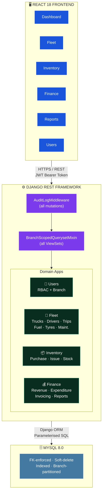

### Request Lifecycle

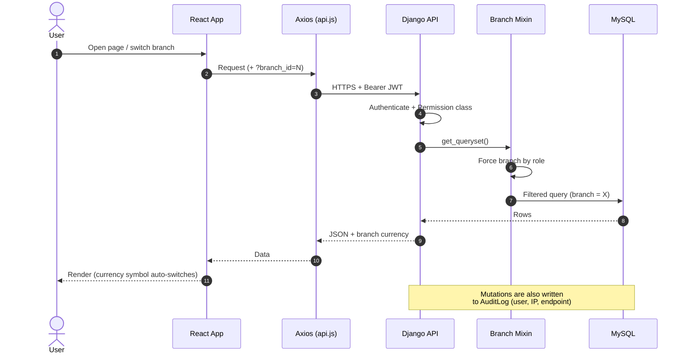


## 🧰 Tech Stack

<div align="center">


</div>

| Layer | Technology | Purpose |
|-------|-----------|---------|
| **Backend** | Python 3.11, Django 4.2, DRF 3.14 | REST API, business logic |
| **Database** | MySQL 8.0 | Relational data, FK-enforced |
| **Auth** | JWT (SimpleJWT) | Stateless auth, token blacklist |
| **Frontend** | React 18, React Hook Form | SPA, real-time form calculations |
| **Charts** | Recharts | Dashboard visualisations |
| **PDF Export** | ReportLab | Invoice & report PDFs |
| **Excel Export** | OpenPyXL | Styled, branded Excel exports |
| **Deployment** | Railway | Backend + Frontend + MySQL |
| **Styling** | Custom CSS Design System | Variables, dark mode, responsive |


## 👥 Role-Based Access Control

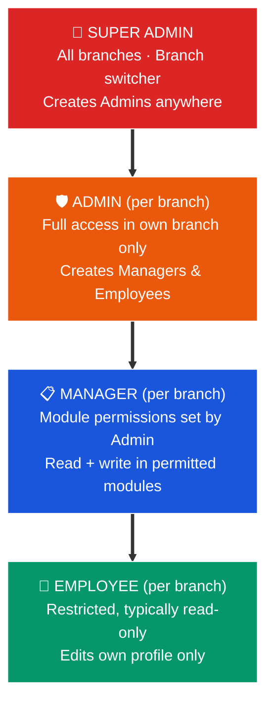

| Capability | 👑 Super Admin | 🛡️ Admin | 📋 Manager | 👷 Employee |
|:--|:---:|:---:|:---:|:---:|
| Access all branches | ✅ | ❌ | ❌ | ❌ |
| Branch switcher in topbar | ✅ | ❌ | ❌ | ❌ |
| Create Admins | ✅ | ❌ | ❌ | ❌ |
| Create Managers / Employees | ✅ | ✅ (own branch) | ❌ | ❌ |
| Promote to Admin / Super Admin | ✅ | ❌ | ❌ | ❌ |
| Users management page | ✅ | ✅ | ❌ | ❌ |
| Full module access in branch | ✅ | ✅ | ⚙️ per-module | ⚙️ per-module |
| Write access | ✅ | ✅ | ✅ (permitted modules) | ⚠️ typically read-only |
| Edit own profile | ✅ | ✅ | ✅ | ✅ |


## 🏢 Multi-Branch System

Every model in the system has a `branch` ForeignKey. The `BranchScopedQuerysetMixin` is applied to **all** ViewSets and enforces isolation at the database queryset level — not just the UI.

```python
# Example: How branch isolation works at the API level
class TruckListCreate(BranchScopedQuerysetMixin, generics.ListCreateAPIView):
    queryset = Truck.objects.all()
    # Super Admin + ?branch_id=2  → only Branch 2 trucks
    # Admin (Branch 1)            → only Branch 1 trucks, always
    # Admin (Branch 2)            → only Branch 2 trucks, always
```

**Frontend branch switching (Super Admin only):**

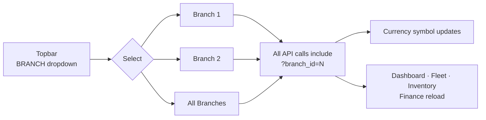


## 💱 Currency Configuration

Each branch has its own currency configured in the database:

| Branch | Currency | Symbol | Code |
|--------|----------|--------|------|
| Branch 1 | Ghana Cedis | `GH₵` | `GHS` |
| Branch 2 | Sierra Leone Leone | `Le` | `SLL` |

Currency is **backend-driven** — set per branch in the `branches` table and returned with every API response. The frontend automatically switches currency symbol when branch changes.

```sql
-- Set branch currency
UPDATE branches SET currency = 'SLL' WHERE id = 2;  -- Sierra Leone Leone
UPDATE branches SET currency = 'GHS' WHERE id = 1;  -- Ghana Cedis
```


## 📐 Auto-Calculation Engine

Every form field auto-calculates in real time with zero manual entry:

| Form | Input Fields | Auto-Calculated |
|------|-------------|----------------|
| **Purchase** | qty × unit_price | `base_amount`, `vat_amount`, `final_amount` |
| **Issue** | qty × last_unit_price | `total_value`, stock validation (blocks if insufficient) |
| **Fuel Log** | litres − fuel_limit | `excess_fuel` (remark required if > 0), `total_cost` |
| **Trip** | loaded_qty − delivered_qty | `qty_difference`, `trip_revenue`, `trip_duration` |
| **Invoice Line** | qty × unit_price | `line_total`, `subtotal`, `vat_amount`, `total_amount` |
| **Maintenance** | labour_cost + parts_cost | `total_cost` |
| **VIT** | last_paid_date + 90 days | `next_due_date` |
| **Tyre Removal** | odometer_remove − odometer_fit | `km_used` |


## 🗄️ Data Model

<details>
<summary><b>📐 Entity-Relationship Diagram (click to expand)</b></summary>
<br/>

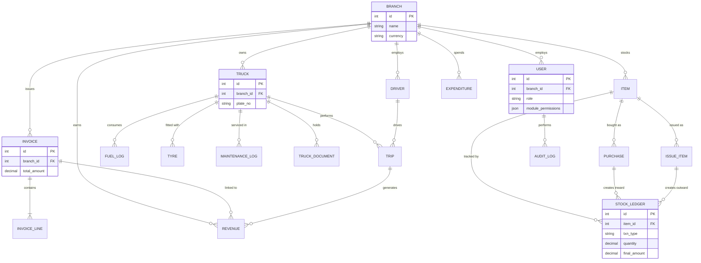

</details>


## 🗄️ Stock Ledger Rules

> ⚠️ Stock is **never** stored as a static field. It is always computed from ledger entries.

```text
closing_qty   = SUM(quantity)      FROM stock_ledger WHERE item = X
closing_value = SUM(final_amount)  FROM stock_ledger WHERE item = X

Inward  (+): OPENING, PURCHASE, TRANSFER_IN
Outward (−): ISSUE, TRANSFER_OUT

Issue blocked at API level if: available_qty < requested_qty
```

**VAT Calculation:**

```text
base_amount  = quantity × unit_price
vat_amount   = base_amount × (vat_pct / 100)   [if vat_applicable = true]
final_amount = base_amount + vat_amount
```

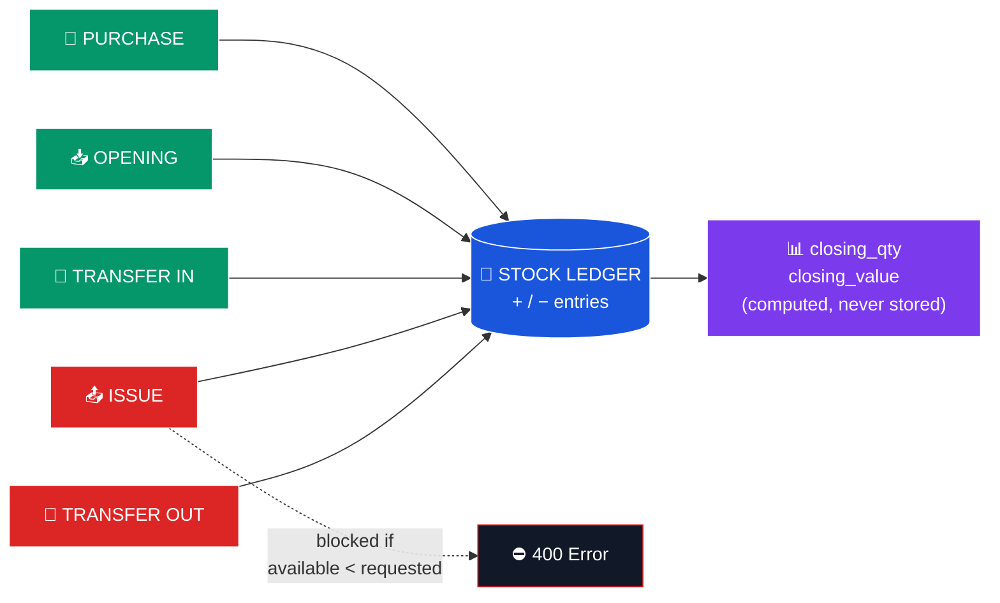


## 🔄 Key Workflows

### 🔐 Authentication Flow

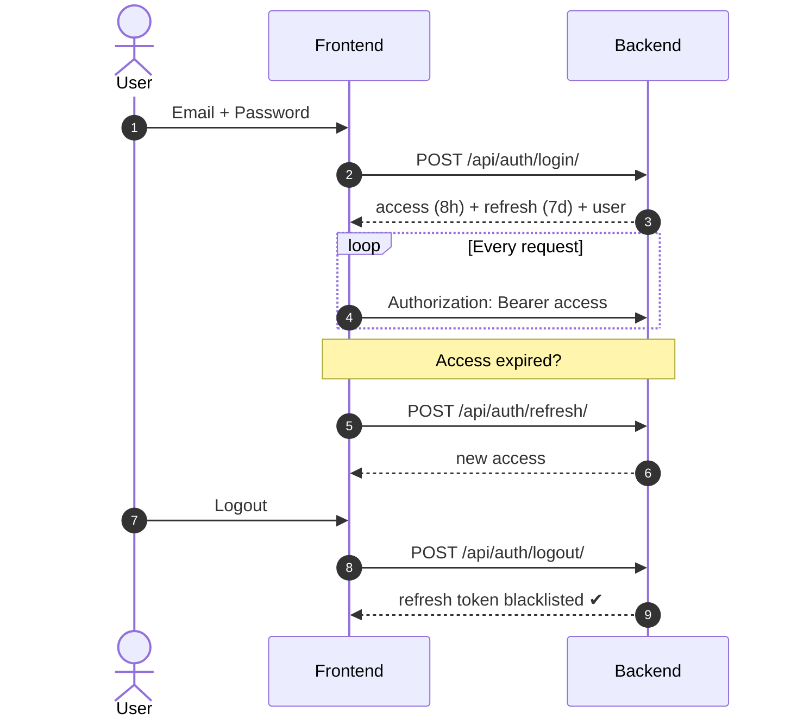

### ⛽ Fuel Log Decision Flow

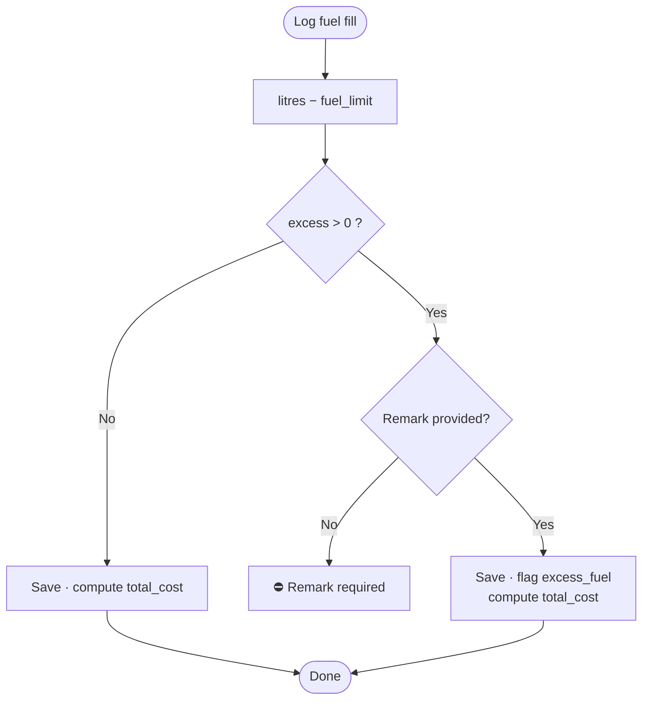

### 📦 Issue Item Flow

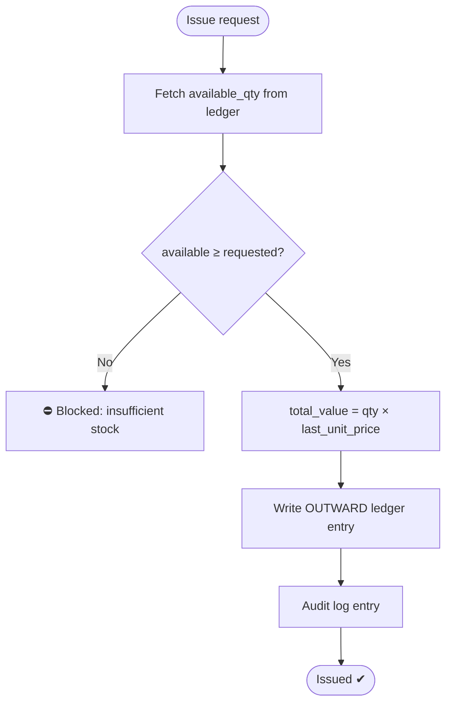


## 📡 API Reference

> All endpoints are JWT-protected (except login) and **branch-scoped** by the backend.

<details open>
<summary><b>🔑 Authentication</b></summary>

```http
POST   /api/auth/login/          → { access, refresh, user }
POST   /api/auth/logout/         → blacklists refresh token
POST   /api/auth/refresh/        → { access }
GET    /api/auth/me/             → current user profile
```

</details>

<details>
<summary><b>🚛 Fleet</b></summary>

```http
GET/POST   /api/trucks/              → list / create trucks
GET        /api/trucks/alerts/       → expiry alerts (branch-scoped)
GET/POST   /api/drivers/             → list / create drivers
GET/POST   /api/trips/               → list / create trips
POST       /api/trips/preview/       → calculate without saving
GET/POST   /api/fuel/logs/           → list / log fuel fills
POST       /api/fuel/preview/        → preview fuel calculation
GET/POST   /api/tyres/               → list / create tyres
POST       /api/tyres/assign/        → fit tyre to truck
POST       /api/tyres/swap/          → swap tyres between trucks
GET/POST   /api/maintenance/logs/    → list / create maintenance records
```

</details>

<details>
<summary><b>📦 Inventory</b></summary>

```http
GET/POST   /api/inventory/items/             → stock items
GET/POST   /api/inventory/purchases/         → purchase orders
POST       /api/inventory/purchases/preview/ → preview without saving
GET/POST   /api/inventory/issues/            → issue items
GET        /api/inventory/ledger/            → full stock ledger
GET        /api/inventory/closing-stock/     → current stock levels
GET        /api/inventory/available-stock/   → available qty per item
```

</details>

<details>
<summary><b>💰 Finance</b></summary>

```http
GET/POST   /api/finance/revenue/             → revenue records
GET/POST   /api/finance/expenditure/         → expenditure records
GET/POST   /api/invoicing/invoices/          → invoices
GET        /api/invoicing/invoices/{id}/pdf/ → download PDF
```

</details>

<details>
<summary><b>📊 Reports</b> <i>(all accept <code>?date_from=&date_to=&format=json|pdf|excel&branch_id=</code>)</i></summary>

```http
GET   /api/reports/dashboard/             → KPI summary
GET   /api/reports/revenue-expenditure/   → P&L report
GET   /api/reports/fuel/                  → fuel consumption report
GET   /api/reports/trips/                 → trip analysis
GET   /api/reports/stock/                 → stock report
GET   /api/reports/invoice/               → invoice summary
GET   /api/reports/maintenance/           → maintenance report
GET   /api/reports/tyres/                 → tyre report
GET   /api/reports/vat/                   → VAT report
GET   /api/reports/lubricants/            → lubricant usage
```

</details>

<details>
<summary><b>🧪 Example: call the API with cURL</b></summary>

```bash
# 1. Login
curl -X POST http://localhost:8000/api/auth/login/ \
  -H "Content-Type: application/json" \
  -d '{"email":"admin@example.com","password":"yourpassword"}'

# 2. List trucks for branch 2 (Super Admin)
curl http://localhost:8000/api/trucks/?branch_id=2 \
  -H "Authorization: Bearer <ACCESS_TOKEN>"

# 3. Download a report as Excel
curl -o fuel.xlsx \
  "http://localhost:8000/api/reports/fuel/?date_from=2026-01-01&date_to=2026-01-31&format=excel" \
  -H "Authorization: Bearer <ACCESS_TOKEN>"
```

</details>


## 📊 Reports & Exports

### Excel Export Format

All Excel exports are fully branded:

| Row | Content |
|-----|---------|
| 1 | Navy company banner |
| 2 | Report title (blue) |
| 3 | Generation date & filters |
| 5 | Sky-blue column headers (bold, frozen) |
| 6+ | Data rows (alternating backgrounds) |
| Last | Navy summary totals row |

### Document Expiry Alerts

Trucks track multiple document expiry dates. The dashboard shows alerts at:

| Level | Trigger |
|:--:|:--|
| 🔴 **Danger** | Already expired (< 0 days) |
| 🟠 **Warning** | Expiring within 30 days |
| 🟡 **Caution** | Expiring within 60 days |

Document types tracked: `VIT` · `Road Worthy` · `Insurance` · `DVLA` · `Fire Extinguisher` · `First Aid Kit`


## 🚀 Quick Start

### ✅ Prerequisites

| Tool | Version |
|------|---------|
| Python | 3.11+ |
| Node.js | 18+ |
| MySQL | 8.0 |
| Git | any recent |

### 1️⃣ Clone

```bash
git clone https://github.com/YOUR_GITHUB_USER/Taurus-logistics.git
cd Taurus-logistics
```

### 2️⃣ Backend

```bash
cd backend

# 1. Create virtual environment
python -m venv venv
source venv/bin/activate          # Windows: venv\Scripts\activate

# 2. Install dependencies
pip install -r requirements.txt

# 3. Create MySQL database
mysql -u root -p
CREATE DATABASE taurus_erp CHARACTER SET utf8mb4 COLLATE utf8mb4_unicode_ci;
EXIT;

# 4. Configure environment
cp .env.example .env
# Edit .env with your DB credentials

# 5. Apply migrations
python manage.py migrate

# 6. Create superuser
python manage.py createsuperuser

# 7. Run dev server
python manage.py runserver
# → API available at http://localhost:8000/api/
```

### 3️⃣ Frontend

```bash
cd frontend

# Install dependencies
npm install

# Start development server
npm start
# → App available at http://localhost:3000
```

### 4️⃣ Database (Raw SQL — skip migrations)

```sql
-- Add currency to branches (if running raw SQL)
ALTER TABLE branches ADD COLUMN currency VARCHAR(10) NOT NULL DEFAULT 'GHS';
UPDATE branches SET currency = 'SLL' WHERE id = 2;

-- Register migration
INSERT INTO django_migrations (app, name, applied)
VALUES ('users', '0005_branch_currency', NOW());
```

### ✔️ Verify It Works

| Check | Expected |
|-------|----------|
| `http://localhost:8000/api/` | API responds (JWT required for protected routes) |
| `http://localhost:3000` | Login screen loads |
| Login with superuser | Dashboard opens, branch switcher visible |


## 🌐 Environment Variables

```ini
# ── Django ─────────────────────────────────────────────
SECRET_KEY=your-secret-key-here
DEBUG=False
ALLOWED_HOSTS=your-domain.railway.app,localhost

# ── Database ───────────────────────────────────────────
DB_NAME=taurus_erp
DB_USER=root
DB_PASSWORD=yourpassword
DB_HOST=127.0.0.1
DB_PORT=3306

# ── CORS ───────────────────────────────────────────────
CORS_ALLOWED_ORIGINS=https://your-frontend.railway.app,http://localhost:3000

# ── Frontend ───────────────────────────────────────────
REACT_APP_API_URL=https://your-backend.railway.app/api
```

> 🔒 **Never commit `.env`.** Keep `DEBUG=False` and a strong random `SECRET_KEY` in production.


## ☁️ Deployment (Railway)

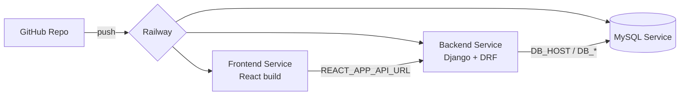

1. Create a Railway project with three services: **MySQL**, **Backend**, **Frontend**.
2. Set the backend variables (`SECRET_KEY`, `DEBUG=False`, `ALLOWED_HOSTS`, `DB_*`, `CORS_ALLOWED_ORIGINS`).
3. Set `REACT_APP_API_URL` on the frontend to the backend's public URL + `/api`.
4. Run migrations on the backend service: `python manage.py migrate`.
5. Create the first Super Admin: `python manage.py createsuperuser`.


## 📁 Project Structure

```text
Taurus-logistics/
│
├── backend/
│   ├── config/
│   │   ├── settings.py          # Django settings
│   │   ├── urls.py              # Root URL config
│   │   └── wsgi.py
│   │
│   ├── apps/
│   │   ├── core/
│   │   │   ├── models.py        # TimeStamped, SoftDelete, AuditLog, SystemAlert
│   │   │   ├── branch_mixin.py  # BranchScopedQuerysetMixin (all views)
│   │   │   └── middleware.py    # AuditLogMiddleware
│   │   │
│   │   ├── users/
│   │   │   ├── models.py        # Branch, User (RBAC + branch FK)
│   │   │   ├── serializers.py   # UserSerializer with branch_currency
│   │   │   └── views.py         # Login, Users CRUD, Branch management
│   │   │
│   │   ├── trucks/              # Fleet: Truck, TruckDocument, expiry_alerts()
│   │   ├── drivers/             # Driver records + licence tracking
│   │   ├── trips/               # Trip management + preview endpoint
│   │   ├── fuel/                # FuelLog, FuelLimit, excess detection
│   │   ├── tyres/               # Tyre lifecycle: fit, remove, swap, km_used
│   │   ├── maintenance/         # Service logs per truck
│   │   ├── inventory/           # Item, StockLedger, Purchase, IssueItem
│   │   ├── finance/             # Revenue, Expenditure
│   │   ├── invoicing/           # Invoice, InvoiceLine, PDF export
│   │   └── reports/             # Dashboard + 10 report types + Excel/PDF
│   │
│   └── requirements.txt
│
└── frontend/
    ├── public/
    │   └── index.html
    │
    └── src/
        ├── App.jsx              # Router, Auth, BranchProvider, CurrencyContext
        ├── index.jsx
        │
        ├── pages/
        │   ├── Dashboard.jsx    # KPIs, expiry alerts, month summary
        │   ├── Trucks.jsx       # Fleet management
        │   ├── Drivers.jsx      # Driver management
        │   ├── Trips.jsx        # Trip logging
        │   ├── Fuel.jsx         # Fuel control
        │   ├── Tyres.jsx        # Tyre lifecycle
        │   ├── Maintenance.jsx  # Service records
        │   ├── Purchase.jsx     # Stock purchases
        │   ├── Issue.jsx        # Stock issues
        │   ├── Stock.jsx        # Stock ledger view
        │   ├── Invoicing.jsx    # Invoice management + PDF
        │   ├── Expenditure.jsx  # Expense tracking
        │   ├── Revenue.jsx      # Revenue records
        │   ├── Reports.jsx      # All reports + exports
        │   ├── Users.jsx        # User management (Admin+)
        │   ├── AuditLog.jsx     # Activity audit trail
        │   └── Profile.jsx      # User profile + password change
        │
        ├── utils/
        │   ├── api.js           # Axios + JWT refresh + currency + calculators
        │   └── BranchContext.js # Re-exports useBranch, useCurrency
        │
        └── styles/
            └── main.css         # Full design system: variables, dark mode, components
```


## 🔐 Security

| Feature | Implementation |
|---------|---------------|
| **Authentication** | JWT with 8h access / 7d refresh tokens |
| **Token Blacklist** | Refresh tokens blacklisted on logout |
| **Branch Isolation** | Enforced at Django queryset level (not just UI) |
| **Role Enforcement** | Permission classes on every API view |
| **Audit Trail** | Every mutating API call logged with user, IP, endpoint |
| **Sensitive Field Masking** | Passwords, tokens masked in audit logs |
| **Rate Limiting** | Login endpoint throttled (10 req/min) |
| **Security Logging** | 401/403 patterns logged to security logger |
| **CORS** | Strict origin whitelist |
| **SQL Injection** | Django ORM + parameterised queries only |

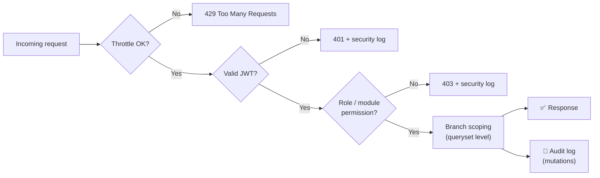

### 🛡️ Reporting a Vulnerability

Please **do not** open a public issue for security problems. Contact the maintainers privately via GitHub and include steps to reproduce.


## 🧪 Testing

```bash
# Backend
cd backend
python manage.py test

# Frontend
cd frontend
npm test
```

**Suggested manual test matrix**

| Scenario | Expected |
|----------|----------|
| Admin (Branch 1) requests `?branch_id=2` | Still sees Branch 1 data only |
| Issue qty > available stock | Request blocked |
| Fuel litres above limit without remark | Validation error |
| Logout then reuse refresh token | Rejected (blacklisted) |
| Switch branch as Super Admin | Currency symbol and data reload |


## 🗺️ Roadmap

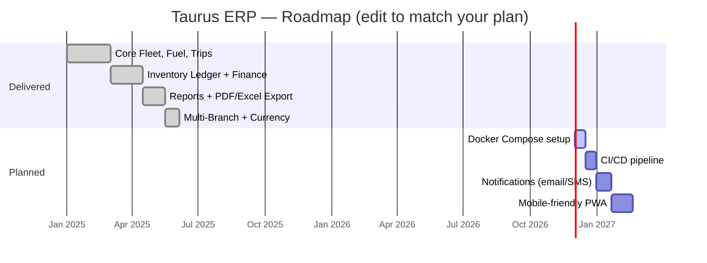

- [x] Multi-branch isolation with RBAC
- [x] Double-entry stock ledger
- [x] Branded PDF / Excel exports
- [x] Backend-driven currency per branch
- [ ] Docker Compose for one-command setup
- [ ] GitHub Actions CI (tests + lint)
- [ ] Email / SMS alerts for document expiry
- [ ] Installable PWA


## 🤝 Contributing

Contributions are welcome!

1. **Fork** the repository
2. **Create** a feature branch: `git checkout -b feature/amazing-feature`
3. **Commit** your changes: `git commit -m "feat: add amazing feature"`
4. **Push** to the branch: `git push origin feature/amazing-feature`
5. **Open** a Pull Request

**Commit convention:** `feat:` · `fix:` · `docs:` · `refactor:` · `test:` · `chore:`


## ❓ FAQ

<details>
<summary><b>Why is stock not stored as a field on the item?</b></summary>
<br/>
Static quantity fields drift out of sync. Computing closing stock from ledger entries keeps every change traceable and auditable.
</details>

<details>
<summary><b>Is branch isolation only a UI feature?</b></summary>
<br/>
No. <code>BranchScopedQuerysetMixin</code> filters at the queryset level on every ViewSet, so even a hand-crafted API request cannot cross branches (except for Super Admin).
</details>

<details>
<summary><b>How do I add a new branch with its own currency?</b></summary>
<br/>
Insert the branch, then set its <code>currency</code> column (e.g. <code>UPDATE branches SET currency='GHS' WHERE id=N;</code>). The frontend picks it up automatically.
</details>

<details>
<summary><b>Can Managers see the Users page?</b></summary>
<br/>
No. Only Super Admin and Admin can access user management.
</details>


## 👨‍💻 Built By

<div align="center">

[](https://github.com/Sandilya-17)
[](https://github.com/gousekareem)

<br/>


<br/>


</div>

## 📜 License

Distributed under the **MIT License**. Add a `LICENSE` file to the repo root to make this official.


<div align="center">

### ⭐ If this project helped you, drop a star! ⭐


<br/>


</div>
